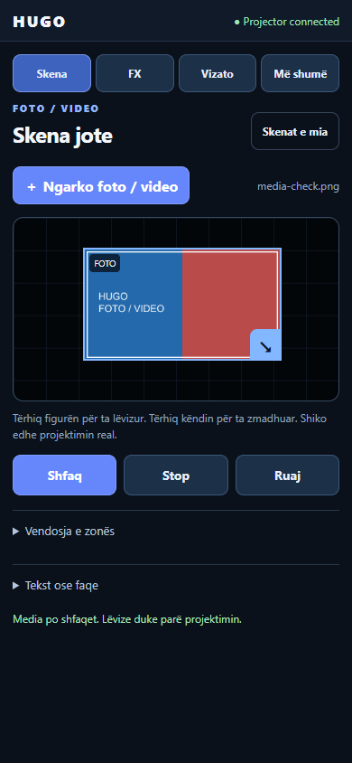
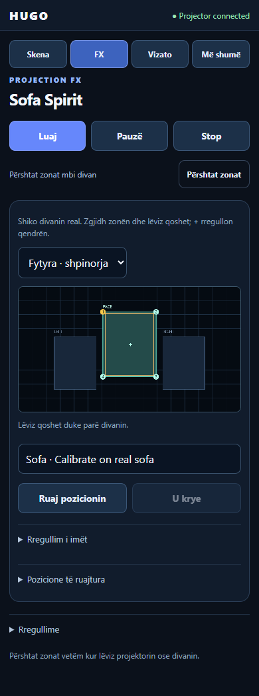

# HUGO Projector

[](https://github.com/IamRedi/hugo-projector-showcase/actions/workflows/ci.yml)

**Ein Android-Projektor als eigenständiges interaktives Gerät.** Das Handy lädt Fotos und Videos hoch, verschiebt ihre Projektionsfläche, zeichnet auf einer Leinwand und steuert originale Lichtillusionen. Die Android-App rendert lokal und liefert ihre eigene Handy-Oberfläche aus. Für den normalen Betrieb ist kein Laptop nötig.

[English](README.en.md) · [Bedienung auf Albanisch](docs/PHONE_USE.sq.md) · [Prüfstand](EVIDENCE.md) · [Architektur](docs/ARCHITECTURE.md) · [Sicherheit](SECURITY.md)

| Foto/Video platzieren | Sofa Spirit steuern | Echter Android-Renderer |
|---|---|---|
|  |  |  |

Die Handy-Bilder sind Browser-Emulationen der Oberfläche, die das echte Gerät ausliefert. Das FX-Bild ist ein Android-Framebuffer-Screenshot. Es ist kein Foto eines realen Sofas. Testmedien und FX-Grafiken sind original; private Aufnahmen und Referenzvideos sind nicht enthalten.

## Was funktioniert

- **Foto oder Video in einer Zone:** hochladen, im 16:9-Editor verschieben/vergrößern, anzeigen und als Szene speichern. Das Seitenverhältnis bleibt innerhalb der Zone erhalten. Positionsänderungen starten den Videodecoder nicht neu.
- **Sofa Spirit:** eine geisterhafte Gesichtsebene und zwei Handebenen, originale RGBA-Grafiken, 9,5 Sekunden mit Einblenden, sanfter Bewegung und Rückzug. Drei separat kalibrierbare Meshes mit Masken und weichen Kanten.
- **Einfacher Ablauf:** Skena → Ngarko foto / video → Shfaq → Ruaj. FX hat Play/Pause/Stop; Details sind eingeklappt. Die aktuelle Handy-Oberfläche ist überwiegend Albanisch, einige ältere Werkzeuge sind Englisch.
- **Canvas:** Zeichnen, Text, Radierer, Undo/Redo, Mapping, Masken und Animationen.
- **Szenen und Portable Mode:** Speicherung auf dem Projektor, lokale Kopplung mit Freigabe am Gerät, Home-WLAN oder vom Projektor bereitgestellter Hotspot.
- **Tank Duel:** originales natives Spiel, solo oder mit zwei gekoppelten Handys. Weitere Retro-Spiele und DS4 sind nicht implementiert.

## Stand

Aktueller Laufzeitstand: **2.3.1-simple / versionCode 7**, Android/Kotlin, Ausgabe 1280×720. Der Besitzer hat am **28. Oktober 2026** sowohl Sofa Spirit als auch die vereinfachte Bedienung als funktionierend bestätigt. Native Geräteprüfungen und Browserprüfungen sind getrennt dokumentiert ([EVIDENCE.md](EVIDENCE.md)). Es gibt keine Behauptung von Holografie oder physischer Stoffverformung.

Dieses öffentliche Repository enthält einen frischen, geprüften Quellcode-Snapshot. Geräte-Schlüssel, Kopplungen, Nutzerbilder, gespeicherte Szenen, Kalibrierungen, private Planung und interne Historie sind nicht enthalten. Es ist ein Source-Available-Showcase zum Lesen und Evaluieren, siehe [LICENSE](LICENSE).

## Bauen

Benötigt: JDK 17 oder 21, Android SDK Plattform 34 und Build Tools 34.0.0. Android Studio kann den Ordner `android/` direkt öffnen. Für die Kommandozeile `ANDROID_HOME` auf das eigene SDK setzen.

```bash
git clone https://github.com/IamRedi/hugo-projector-showcase.git
cd hugo-projector-showcase/android
./gradlew :app:assembleDebug
# Windows: gradlew.bat :app:assembleDebug
```

Die APK entsteht unter `android/app/build/outputs/apk/debug/app-debug.apk`. Sie verwendet den eigenen lokalen Debug-Schlüssel. Eine damit gebaute APK kann eine Installation mit einem anderen Signaturschlüssel nicht aktualisieren; für die Evaluation ein separates Testgerät verwenden. SDK-Pfade, Schlüssel und APKs gehören nicht ins Repository.

```bash
python3 tools/check_public_export.py
python3 -m unittest discover -s tests -v
```

Der deklarierte Mindeststand ist API 26; Gerätebelege stammen von Android 14. Andere Firmware-/Android-Versionen wurden nicht pauschal freigegeben.

## Grenzen

HTTP/WS läuft derzeit unverschlüsselt im vertrauenswürdigen lokalen Netz. Kopplung und Berechtigungen sind implementiert; TLS/WSS und Internet-Fernzugriff sind nicht implementiert. Auf der geprüften Firmware kann der OEM-Launcher nach dem Boot zuerst erscheinen; dann öffnet Home die App. OEM-Keystone, Fokus, HDMI und Lampensteuerung sind keine implementierten App-Funktionen. Ein schwarzes Bild schaltet die Lampe nicht aus.

HUGO Core ist ein separates Projekt. Eine spätere DeviceAdapter-Anbindung ist geplant, in diesem Snapshot aber nicht implementiert. Der Projektor arbeitet unabhängig davon.

## Aufbau

```text
android/app/src/main/java/com/hugo/projector/
  LocalController.kt      HTTP/WS, Kopplung und Autorisierung
  MainActivity.kt         native Szenen und Medien-Zone
  CanvasEngine.kt         gespeicherter Zeichen-/Mapping-Zustand
  MediaPlacement.kt       validierte normalisierte Medienfläche
  TankDuel.kt             lokale Spielsimulation
  fx/                    Timeline, Mesh-Renderer, Kalibrierung
android/app/src/main/assets/
  controller/            Handy-Oberfläche ohne Frontend-Buildschritt
  fx/                    originale transparente Sprites und Manifest
docs/                    Nutzung, Architektur, Herkunft und Snapshot-Hashes
```

## Lizenz und Komponenten

Quellcode zum Lesen und Evaluieren, keine allgemeine Produktions- oder kommerzielle Nutzungslizenz: [LICENSE](LICENSE). Gradle und ZXing unterliegen ihren eigenen Lizenzen; [THIRD_PARTY_NOTICES.md](THIRD_PARTY_NOTICES.md). Die Grafiken wurden neu erzeugt; Herkunft und genaue Prompts stehen in [ASSET_PROVENANCE.md](docs/ASSET_PROVENANCE.md).
