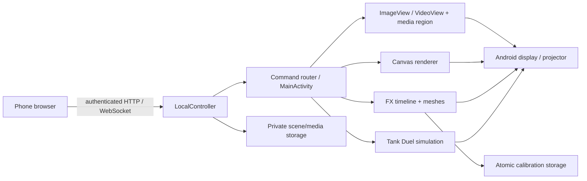

# Architecture

`ProjectorRuntime` owns the local controller independently of the Activity. Normal phone use communicates over Wi-Fi or LocalOnlyHotspot; ADB is a development tool only. The legacy `AgentConnection` client is retained in the snapshot but is not started by the current runtime.

The existing version 2 envelope carries command ID and expiry. The active editor's token/session is required for mutation; viewers do not gain edit access by opening another page. ACK reports command application, while status exposes loading/ready state and drawn-frame timestamps.

Media uses one rectangular normalized region. Layout changes reuse the native media view; Stop pauses and hides it, storing a stopped flag for process restoration. Canvas, scene library and FX calibration have separate persistence. FX uses three 8×8 meshes, cached alpha masks and two decoded source sprites, with the right hand mirrored. Choreographer schedules the intentional 30 Hz animation. Leaving FX releases its renderer and bitmaps.

No image-generation service runs on Android. There is no cloud, HUGO Core dependency, object tracker, automatic sofa calibration, firmware adapter or realtime 3D engine. Physical alignment is manual and remains valid only while projector and object stay fixed.
